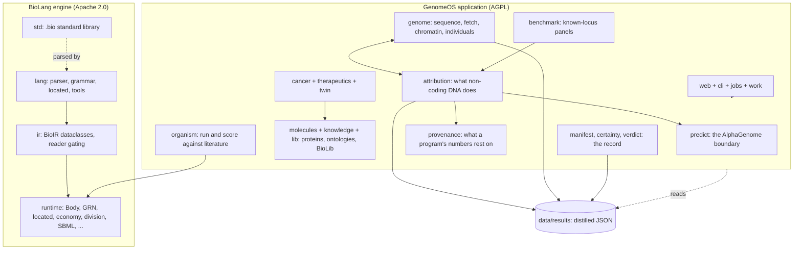
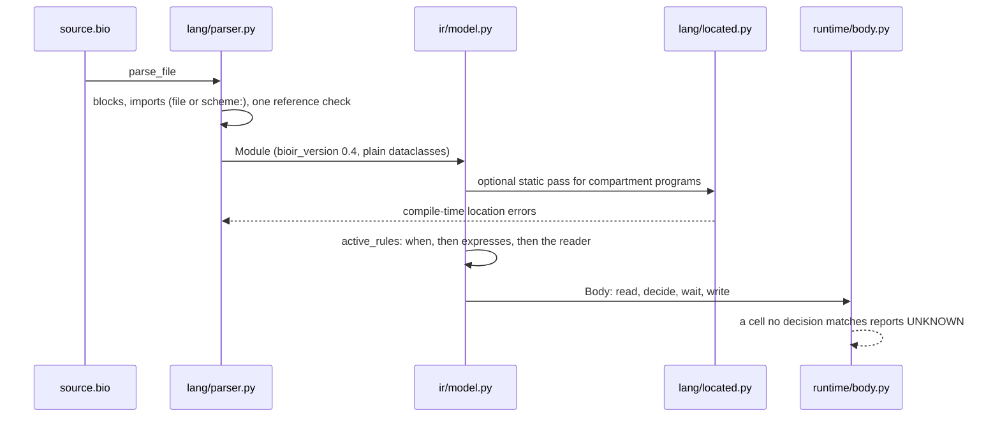

# Codebase map

A guide to where things are and why they sit where they do. It describes the
**committed** code at `56f0e65` (2026-10-10); `data/` and `docs/` are named but
not described, and work that was uncommitted in the checkout while it was read
is left out on purpose. **Every one of the 280 Python modules under
`genomeos/` is named below**, in its package, with what it is for.

**Three readings.** First mapped on 2026-09-21 at `9a40c18`; re-read on
2026-09-22 at `005803f`, eighty commits later; re-mapped whole on 2026-10-10
(ROADMAP §5 item 14, E5), when 120 of the then 279 modules — 49 of them in
`attribution/` — the package `provenance/` and `tests/conftest.py` had all come
after the map. The first two readings stay in the frontmatter's `first_*` and
`remapped*` fields. Seven commits landed while this reading was made and are in
it, among them the BioLang `reader` block (`5682e6c`) and
`attribution/runrules.py` (`37ece3a`).
For what the project is for, read [README.md](../README.md); for why the code
is shaped this way, [ARCHITECTURE.md](ARCHITECTURE.md) and
[DECISIONS.md](DECISIONS.md).

Measured at `56f0e65`: **1,991 tracked files** — `genomeos/` 299, `tests/` 393,
`scripts/` 287, `docs/` 39, `data/` 960 (most of them in `data/results/`) — and
**337,105 lines of tracked Python**, 151,169 of them in `genomeos/`. At the
first mapping the same tree was 542 files; at the second, 1,365 files and
152,160 lines. Token counts were measured once, on 2026-09-21, and not again.

The six largest committed source files, which no one should Read whole:
`web/static/index.html` (261 KB), `cli.py` (247 KB), `web/server.py` (159 KB),
`attribution/human_panel.py` (148 KB), `benchmark/loci.py` (131 KB),
`attribution/target_calibration.py` (126 KB). Find the symbol with
`grep -n`, then read a range.

## The one rule that shapes everything

**The application may import the engine. The engine may never import the
application.**

That was an architectural rule before it was a licensing one. Since
2026-09-11 the engine is Apache 2.0 and the application is
AGPL-3.0-or-later, so an engine file importing an application module would
be a work based on AGPL code and could not honestly be distributed as
Apache. [tests/test_engine_boundary.py](../tests/test_engine_boundary.py)
parses the AST of every engine file and fails loudly, not with a warning.
[scripts/package_engine.py](../scripts/package_engine.py) goes further: it
repackages the engine subtree alone and proves it runs and self-tests with
no GenomeOS and no site-packages present.

| Half | Paths | Licence |
|---|---|---|
| BioLang engine | `genomeos/lang`, `ir`, `runtime`, `std`, `coords.py`, `version.py`, `bio.py` | Apache 2.0 |
| GenomeOS application | everything else under `genomeos/`, plus `scripts/` and `tests/` | AGPL-3.0-or-later |

**No package mixes the two.** All 31 engine `.py` files open with
`SPDX-License-Identifier: Apache-2.0`; of the 249 application modules, 155 open
with the AGPL line and 94 carry no header and take their licence from their
path (cancer/, flow/, twin/, web/, most of genome/ and therapeutics/, `cli.py`,
`results.py`, `work.py`). The seven `std/*.bio` files carry no header either.
On 2026-10-03 (`76859cb`) five census modules that had grown inside `lang/`
moved out to the application package `provenance/`, so the engine holds only
the language.

Two console entry points follow the same line: `bio` is the engine
toolchain and works standalone; `genomeos` is the application. The one seam
between them is the entry-point group `biolang_import_resolvers` in
`pyproject.toml`: the engine's parser looks there for `import scheme:NAME`
sources it does not ship, and the application registers
`protein = genomeos.lib.biolang:resolve_protein`.

## The second rule, added 2026-09-22

**A number is trusted for the population it was measured on and no further.**

Eighty commits in one day were one finding in four areas, and the code now
carries the rule in three shapes. A newcomer who learns only this will read the
result files correctly.

1. **A silence is named, never a zero.** `attribution/targets.py` defines
   `Response(value, reason)` with `SCORED`, `NOT_IN_WINDOW`, `NOT_ON_TRACK`,
   `NOT_CACHED`. The idiom exists because a table that had *no row* for a gene
   was returning `0.0` and every consumer read it as *the model predicts no
   effect* — 97.7% of the CRISPRi benchmark's held-out pairs. The same idiom is
   in `eqtl.py` (`cache_silence`), `crispri.py` (`deletion_answered`) and
   `target_calibration.py` (`gate_silences`).
2. **A threshold is not a measurement.** `MIN_EFFECT`, `UNION_DROP`,
   `MIN_POOLED_FOR_A_BAND`, `STRICT_RELATIVE`, `node_open_threshold` and
   `PROVISIONAL_CEILING` are decision bars. A compact `predicted = null` means
   *nothing cleared the bar*, not *nothing was scored*. Any rate conditioned on
   such a field is conditional on the gate.
3. **A curve is honest only on the population it was fitted on.** The
   confidence that banded the genome was fitted on 245 pairs at a 76.7% base
   rate and, one stratum off, quoted 0.4126 where the screens measured 0.0603.
   `target_calibration.py` now carries the gate census, the re-banding, the
   union axis and the prevalence offset — and the genome-wide band table is
   **retired**, not corrected. What stands is a measured rate per stratum, with
   `NOT_CALIBRATED = "not calibrated here"` said out loud for the 90% that
   cannot carry a number.

The convention that produced all of it: **a module carries its own
pre-registration as a constant, committed before the measurement runs.** Look
for `PREREGISTRATION`, `PREREGISTERED_*`, `CAP_RAISE`, `ENSEMBL_JOIN`,
`AMENDMENT`, `THE_GATE`. They fix the metric, the baselines, the expected
direction and the falsifiers in advance, and several of them record that their
own prediction was wrong. `genomeos/forge/calibration.py` is the extreme case:
a module whose entire result is a registered refusal to publish a rate.

Since 2026-09-28 the rule has a third carrier besides the code and the result:
**the record**. `manifest.py` says what a result was made from, `certainty.py`
keeps apart five quantities a single `confidence` used to blur, and
`verdict.py` writes a check's outcome to a file that names the tree it judged.

## System overview



The arrow between `genome` and `attribution` runs both ways: `genome/` imports
`attribution.bigwig`, `budget`, `constraint`, `eqtl`, `onetarget2` and
`targets` (in `epigenome.py`, `rna_measured.py`, `duplications.py`,
`regdiff.py`), and `attribution/` imports `genome/` from 52 places. Inside the
application the layering is a convention, not a rule; only the engine line is
enforced.

## Directory structure

```
genomeos/
  coords.py results.py version.py   the three things everything may import
  cli.py bio.py                     two entry points, two licences
  lang/ ir/ runtime/ std/           the engine
  manifest.py certainty.py verdict.py importable.py compare.py   the record and its checks
  evidence.py evidence_discovery.py response_map*.py decompile.py report.py   read-only views
  jobs.py work.py roadmap.py storage.py design.py   product plumbing
  genome/                           sequence, fetch, chromatin, per-person genomes
  attribution/                      the largest package: what non-coding DNA does
  predict/                          the AlphaGenome boundary
  knowledge/ molecules/ lib/ flow/  ontologies, proteins, the BioLib catalogue, DNA to protein
  organism/ benchmark/              run programs, score against literature
  cancer/ therapeutics/ twin/       the applications
  forge/                            BioForge: design under constraints
  provenance/                       what each number of a hand-written program rests on (from lang/, 2026-10-03)
  web/                              stdlib HTTP server and the static UI
scripts/    287 standalone runners; nothing imports them
tests/      393 files: 385 test files, conftest.py and seven shared helpers
data/       committed: results/, demo/, organisms/, ledgers/, models/, twins/, patterns/;
            git-ignored: reference/, knowledge/, cache/, individuals/, jobs/, work/, quarantine/
docs/       39 documents; ROADMAP.md is the single plan, ROADMAP-HISTORY.md its frozen past
```

## How a .bio program runs



`Module.to_dict()` round-trips through plain JSON, so BioIR can be produced
and diffed outside Python. `import protein:TP53` resolves through a scheme
resolver that `lib/biolang.py` registers against the packaged proteome.

## Module guide

Each package below is named with its file count (`__init__.py` included) and
what it reads and writes. An `__init__.py` re-exports the package's public
names and holds its docstring; the ones that do more are said where they do.

### The engine

**`genomeos/ir`** (2 files) — `model.py` is the whole type system: one
dataclass per block kind, from `Gene` and `Protein` to `Timer`, `Decision`,
`Competence`, `Pool`, `Cost` and, since 2026-10-10, `Reader`. Three invariants
hold by construction: every rule carries evidence and a confidence, `UNKNOWN`
is a legal value that is never invented, and a rule applies only where its
`when` matches. Rule selection lives here too: `Module.active_rules` applies
`when`, then `expresses`, then the reader, and `Module.reader_gate` gives each
gated rule its state and the reason. Imports nothing but `coords`.

**`genomeos/lang`** (5 files) — `parser.py` compiles source to a `Module`,
handling nested blocks, diamond imports and scheme resolvers.
`grammar.py` holds the `BLOCKS` table, renders
[BIOLANG-GRAMMAR.md](BIOLANG-GRAMMAR.md), and its `check()` fails when the
parser or the IR dataclasses drift from that table. `located.py` is static
analysis for compartmentalised programs. `tools.py` is written against
`lang`, `ir` and `runtime` only, so `bio` works alone; `bio check --context`
prints the rules a reader holds, by state.

> **The reader construct** (`5682e6c`, [BIOLANG-v0.5-READER.md](BIOLANG-v0.5-READER.md)):
> `reader <CellType> { open: ...; poised: ...; closed: ...; unknown: ... }`
> states which elements a cell type reads, and `through: E` names the one
> element a rule acts through. Only `open` runs the rule; every other state,
> and every way of not knowing, holds it as a copy at strength 0, never removes
> it, because the network runtime transcribes a gene with no activator at its
> full rate. `data/demo/reader_gating.bio` is the example.

> `parser.py`'s docstring still says "BioLang v0.3", and `grammar.VERSION` and
> the IR's `bioir_version` still say 0.4, while the parser accepts the 0.4
> blocks and the v0.5 `reader`.

**`genomeos/runtime`** (21 files) — `body.py` (1,446 lines) is the organism
engine: decisions scheduled by priority then module order, timers scaled by
tempo and generation, cells moving in space, networks co-simulated. Other
engines each take one IR subset: `grn.py` (Hill ODEs), `located.py`
(species are molecule-compartment pairs, transports saturate so cargos
compete), `methylation.py` (raises rather than defaulting a missing
parameter), `sbml.py` and `boolean.py` (zero-dependency stand-ins for
libRoadRunner and MaBoSS), `cell.py` (four ageing clocks), `economy.py`
(stage 2: pools and costs; a cost naming an undeclared pool is an error, not a
silent no-op), `division.py` (stage 4: a `divide` with `partition: contents`
splits the parent's contents between the daughters instead of copying them),
`spatial.py` (a 2-D field with diffusing morphogens), `segmentation.py`
(clock and wavefront), `gastrulation.py` (germ layers read from a NODAL
gradient). Support: `central_dogma.py`, `variant_effect.py`,
`uncertainty.py`, `debugger.py` (`explain()` traces a state change back to
the rule and its evidence), `compose.py` (the engines as process-bigraph
processes, under the optional `compose` extra). `__init__.py` re-exports
the engines.

> `abundance_gate.py`, `burden_gate.py` and `division_gate.py` contain **no
> executable code**. They are pre-registrations of the stage gates encoded as
> Python constants, written before the instrument and before any run. Reading
> them expecting logic will mislead.

**`genomeos/std`** — the BioLang standard library as `.bio` source, seven
files. `signalling.bio` holds 148 ligand-receptor pairs from CellPhoneDB v5;
`human_stages.bio` 24 Carnegie stages; `human_turnover.bio` one timer per
cell type from Sender & Milo 2021; `ageing.bio`, `cell_types.bio` and
`development.bio` the rest of the prelude. `methylation.bio` leaves values
`unknown` where the literature does not establish them, so the engine
refuses to run until a program binds them as its own labelled assumptions.

**`version.py`, `coords.py`, `bio.py`** — the version string on the engine
side of the split; strand and locus; and the `bio` command (`check`,
`compile`, `run`, `test`, `repl`) over `lang/tools.py`.

### The top level: the record, the views, the plumbing

Twenty-three modules sit directly in `genomeos/`. Apart from `coords.py`,
`version.py` and `bio.py` above, all are application.

- **The record.** `results.py` is the registry: `save_result` writes the
  distilled outcome of every real-data run to `data/results/`, and
  `scripts/results_writer_census.py` lists the places that write there without
  it. `manifest.py` (review R9) is the provenance contract each result carries
  under `result_manifest`: sources, bytes, assembly, code revision,
  parameters, exclusions, partitions; from the moment it is imported it traces
  every file opened under `data/`, and it computes a study's `counting_path`,
  the transitive import closure of the script that wrote it. `certainty.py`
  (review R4) keeps evidence category, effect size, spread, model score and
  probability of being right as five quantities, and a probability cannot
  exist without its record. `verdict.py` writes a check's verdict to a status
  file keyed by the tree it judged, because four exit codes lied in one night.
  `importable.py` asks the import finders, not `sys.modules`, whether an
  optional module is present — the gate for the paid client. `compare.py`
  standardises two groups and prints the imbalance beside any effect.
- **Read-only views.** `evidence.py` lists one row per stated fact across every
  `.bio` program (the Evidence tab). `evidence_discovery.py` arranges the
  committed `discovery_review.json` for the same tab. `response_map.py`,
  `response_map2.py` and `response_map3.py` are the cellular control and
  response map in three increments: one locus by reference, every locus with
  all three inputs (110 of them), one chain through several kinds of evidence.
  `decompile.py` is one gene with every layer read for it and what stays
  unknown (`genomeos decompile`). `report.py` is the gene dossier (`genomeos
  report`, `/api/report`).
- **Plumbing.** `cli.py` and `web/` are described under the product below.
  `jobs.py` runs whitelisted background jobs, logging to `data/jobs/`.
  `work.py` is the work board (`genomeos work start|update|done|list`) in
  `data/work/`, with `stale` at six hours and `ABANDONED_AFTER` at 48.
  `roadmap.py` reads `docs/ROADMAP.md` into areas and finished items for the
  Progress tab. `storage.py` is `genomeos data status|distil|clean`; it never
  deletes under `data/results/`. `design.py` answers design budgets ("how much
  of the genome does a neuron need") from library membership.
  `__init__.py` carries the package docstring and version.

### The genome layer

**`genomeos/genome`** (35 files, 12,424 lines) — reads `data/reference/` and
`data/knowledge/*`, writes `data/results/`. Storage and random access
(`sequence.py`, `genome.py`, `fasta.py` streaming, `index.py` random access,
`bgzf.py` — BGZF rewrites are verified by SHA-256 so no FASTA is ever kept
twice — `bam_range.py`, an indexed BAM by HTTP range, and `variants.py`, VCF
read and apply). `fetch.py` brings a chromosome online (`genomeos data fetch
--chrom chrN`). Gene models and reading the sequence: `annotation.py`
(GENCODE GFF3 to BioIR), `anatomy.py` (count a chromosome's blocks and
elements), `signals.py` (learned splice and start signals, `genomeos signals
learn|scan`), `segments.py` (segment parser v1: chains those signals into
candidate genes, never asserting), `unknown.py` (classify the space between
genes, largest block first). Structure and regulation: `blocks.py`,
`domains.py` (CTCF-only, no Hi-C), `regulatory.py` (ENCODE SCREEN cCREs),
`regulation.py`, `motifs.py` (the `requires:` lists and operators),
`repeats.py`, `duplications.py` (UCSC segmental duplications). Measured
chromatin, RNA and 3D: `epigenome.py` (1,225 lines), `reader.py` (which nodes
a cell type reads), `rna_measured.py` (ENCODE RNA-seq bigWigs as evidence for
the parser), `hic.py`, `hic_contact.py` (reads remote `.hic` by range request
without downloading). The per-person layer: `individuals.py` (1,793 lines;
import a VCF once into the git-ignored `data/individuals/`), `clinvar.py`,
`missense.py`, `polygenic.py`, `diff.py`, `regdiff.py`, `lookup.py`,
`telomere.py` (TelSeq-style length from reads). `mouse.py` runs mm10 through
the same domain code path.

Every fetcher follows one pattern: **stream, distil, discard.** Sources are
UCSC, GENCODE, ENCODE, 4D Nucleome, ClinVar, GIAB, AlphaMissense, the PGS
Catalog, JASPAR, MGI and Ensembl Compara.

**`genomeos/predict`** (8 files) — the model boundary. Every module shares
one pattern: a scorer injected at call time so tests avoid the network, a
1,048,576 bp window, a disk cache under `data/knowledge/alphagenome/`,
retry with backoff, and **confidence capped at 0.7, evidence kind
`PREDICTED`, never labelled experimental**. `alphagenome_adapter.py` turns
predicted effects into `predicted` rules and keeps each answer's full track
vector through `attribution.astrorun.full_vector_entry`. `enhancer_target.py`
is the one the benchmarks and sweeps consume. The others each answer one
AlphaGenome use: `chromatin_tracks.py` (chromatin per cell line where it is not
measured), `contact_maps.py` (node boundaries from a predicted contact map),
`individual_effects.py` (a person's regulatory variants on one gene),
`rna_tracks.py` and `splice_sites.py` (second opinions for the segment parser).
The `predict` extra installs the client.

### The 98%: `attribution/` by role

**`genomeos/attribution`** (81 files, about 67,200 lines — the largest
package) — what non-coding sequence does, and how much of that is evidence
rather than prediction: ROADMAP area I, with area J's per-block readings. Almost
every module is a study: it holds its registration as constants, a `run` or
`count` function, and a runner in `scripts/` with the same stem (often a
`*_register.py` committed first and a `*_run.py` after) that writes one file
in `data/results/`. It reads `data/knowledge/alphagenome/` (the deletion
caches), `data/reference/`, `data/cache/` and earlier results. Seven modules
are wired into the CLI — `budget`, `compile`, `closure`, `organise`, `syntax`,
`variation`, `measured` — and the rest are reached from their scripts and
tests. `__init__.py` holds only the docstring. Read the groups in this order.

1. **Transport and constraint.** `bigwig.py` is a stdlib-only bigWig reader
   over HTTP range requests that streams the 9.6 GB Zoonomia phyloP without
   downloading it (`genome/epigenome.py`, `genome/rna_measured.py` and
   `knowledge/satmut.py` use it too). `constraint.py` puts constraint from two
   public sources over UNKNOWN blocks; eleven modules import it.
   `variation.py` is the second axis: within 76,156 people (gnomAD Gnocchi)
   beside 241 mammals (`genomeos variation`). `mappability.py` measures the
   library oligos' mappability; `rpm.py` computes reads per million in an
   element from alignments by its own definition.
2. **Tiers and the block organiser.** `budget.py` gives every UNKNOWN block a
   tier — structural, fossil, regulatory, constrained_unknown, neutral — and
   twelve modules import it (`genomeos budget`). `organise.py` reads each block
   with all the evidence there is, copies first: the human axis and the
   segmental-duplication flag on top of the tier (`genomeos organise`).
   `syntax.py` says which bases of a gene never change and which ones people
   differ at (`genomeos syntax`). `syntax_tiling.py` tiles the 69 syntax blocks
   against two matched arms (never ran). `candidates.py` reads the constrained,
   unannotated blocks one by one. `element_types.py` discovers element types
   from deletion behaviour. `unknown_scoring.py` asks what deleting all 12,139
   chr21 elements bought the 98%, at zero requests.
3. **Many genomes and the panel background.** `human_panel.py` (3,643 lines)
   reads the HPRC 90-assembly alignment by range request into a per-chromosome
   store: what is fixed, what holds a value, what cannot be placed. The family
   below it imports the previous one: `panel_background.py` (what the matched
   background is made of) → `panel_leftover.py` (the 2,006 Mb the budget never
   cut into a block) → `panel_union.py` (four covariates at once) →
   `panel_union_five.py` (segmental duplication, the one that runs the other way).
4. **Lexicon, grammar and compression.** `lexicon.py` indexes the genome's
   units at every scale with the nulls that make counts real; `lexicon_axes.py`
   replaces its three soft proxies with base-resolution axes and runs JASPAR at
   the calibrated threshold. `motif_grammar.py` asks whether the arrangement of
   sites beats their presence; `motif_transfer.py` whether §17's one positive
   transfer is a property of the reporter construct. `compress.py` (2,425 lines)
   measures bits per base under generic models and under the biology the
   project knows. `satmut_vista.py` compares in-silico mutagenesis over VISTA
   with conservation.
5. **The deletion layer and its readers.** Start at `targets.py`:
   `Response(value, reason)`, `run_elements` (the compact table, one gene per
   element) and `ElementResponses` (the per-element cache, every gene in the
   window, signed); 21 modules import it. Around it: `onetarget2.py` (the
   census of the remaining one-target consumers, one registration with a
   falsifier per module), `gene_identity.py` (which gene a rule names against
   which gene the answer measured), `gene_row_locus.py` (tie a cached gene row
   to a locus), `label_gene.py` and `argmaxcell.py` (whether a rule's `when:
   cell_type` belongs to the element, the gene or the locus, and whether the
   argmax cell carries cell-type information), `context_evidence.py`
   (chromatin evidence for the cell a rule names, or a label saying why there is
   none), `not_open_profile.py` (the `not_open_in_reader` rules, typed and
   located), `direction_v2.py` (a rule's direction versioned: v1 as committed,
   v2 read in the rule's own cell), `respmap_v2.py` (v2 per published
   assertion of the response map), `clause1.py` and `cellcover.py` (whether
   v2's clause (1) secures its own reason, and what a second value per cell
   would cost).
6. **Compile, measure, simulate, run.** `compile.py` writes a chromosome's
   attributions as a BioLang program into `data/organisms/human/`, predicted
   rules capped at 0.7, its defaults made visible through
   `provenance/compiled_defaults.py`. `reheader.py` versions a published
   program whose header sentence was false. `measured.py` is the experimental
   layer: what four assays measured over each compiled element; 17 modules
   import it. `bridge.py` (review R3) goes from executable annotation to a
   parameterised simulation on `runtime/grn.py` and no further. `runrules.py`
   (M1, 2026-10-10) asks whether a run of the compiled rules predicts measured
   RNA, holding its census, registration and test in the order they were
   committed. `closure.py` is the gene-level closure test, do the attributions
   reproduce what the cell makes (`genomeos closure`). `executor.py` (2,179
   lines) asks whether a block executes the value stored in it; `wiring.py`
   whether the deletion assignments beat matched rewired ones.
7. **Ground truth: measurements held against the attribution.** Reporter and
   in-vivo assays: `mpra.py` (ENCODE4 lentiMPRA), `vista.py` (VISTA
   transgenics). Associations: `eqtl.py` (GTEx), `gwas.py` (GWAS Catalog).
   Perturbations: `crispri.py` (the CRISPRi screens; 15 modules import it),
   `crispri_direction.py`, `crispri_direction_both.py`, `direction_link.py`
   (sign agreement per link against a sign-shuffled control). Comparators:
   `re2g.py` (paired against ENCODE-rE2G on identical held-out pairs),
   `indep.py` (a benchmark no script had read), `joint_pretest.py` (R8: does a
   coupling term beat independent scoring). Eligibility and populations, each
   counted before any test: `fresh.py` (a CRISPRi set outside K562 never read),
   `cell2.py` (independent loci for a second cell type), `hct116_count.py`,
   `increases.py`, `increase_links.py`, `reptest.py`, `rescore_cost.py`,
   `repress2.py` (the compiler's repression calls). The silencer pair:
   `silenceragree.py` (assay-validated ReSE silencers against the model's
   signed direction) and `silencerdoctrine.py`, the guard on the predicted
   `silencer_like` key and on prose about it — its corpus includes
   `docs/*.md`, this map among them. `measurability.py` says what a reporter
   assay could not measure in the 13.77 Mb nothing has measured yet.
8. **N1, the Perturb-seq response test.** `n1_perturb_response.py` (frozen
   before any measurement: do the motif-to-gene predictions anticipate a
   factor's knockdown response better than promoter proximity, on Replogle 2022
   K562), `n1b_calibration.py` (is the per-gene statistic calibrated on the
   non-targeting rows), `n1_coverage.py` (why 44 of 56 factors have no
   responders).
9. **Calibration and stated confidence.** `target_calibration.py` (2,481
   lines; see below), `confidence_calibration.py` (do the project's own
   confidences mean anything), `confidence_census.py` (review R4b: every stated
   `confidence` outside the compiler), `ablation.py` (which conclusions survive
   on experimental evidence alone).
10. **Correctness, coherence and the next experiment (review items 12 and
    13).** `correctness.py` keeps five claims apart — origin, molecular role,
    activity, target, context (S4). `holdout.py` is the leave-one-source-out
    harness (C4) and the only scorer of C1 to C3. `pilot.py` and `pilot_bio.py`
    are the coherence pilot on synthetic and on real evidence.
    `experiment_value.py` (S8) fixes the questions a design must answer before
    volume.
11. **AstroREG, the paid-run machinery.** `astroreg.py` registers the
    astrocyte CRISPRi test with every term fixed before any score.
    `astrorun.py` (2,330 lines) is the authorised run, three things kept
    separate on purpose: the money guard (Albert authorised a number of
    requests, not a job), the request list, and the gate on the one input the
    frozen model needs. `astroargmax.py` is item (h), registered and nothing
    else. The runners: `scripts/astroreg_register.py`, `astroreg_dry_run.py`
    (the request list priced, nothing sent), `astroreg_activity_gate.py`,
    `astroreg_calib_register.py`, `astroreg_rpm_calibrate.py`,
    `astroreg2_register.py` (AstroREG-2, gated on endpoint validity),
    `astroreg2_astrocyte_activity.py`, `astroreg2_endpoint.py`, and
    **`astroreg2_send.py`, the only script in the project that may buy an
    astrocyte answer**. It refuses by default and on every clause separately,
    and writes the committed ledger `data/ledgers/astroreg2.jsonl` beside the
    sign-off in `astroreg2_signoff.json` and `.jsonl`.

### Everything on top

**`knowledge/`** (10 files) — reads and writes `data/knowledge/`. `obo.py`
parses OBO for GO, Cell Ontology and Uberon, under `go.py` (GAF annotations),
`cells.py` (Cell Ontology cell types) and `reactome.py` (flat gene-to-pathway
membership). `ligand_receptor.py` reads CellPhoneDB. `homology.py` streams
Ensembl Compara once to place each gene on a clade ladder (`genomeos origin`).
Area J: `profiling.py` (which libraries were gained and lost together across
the tree, `genomeos profiling`) and `across.py` (one locus in mouse, chicken
and fish, `genomeos across`). `satmut.py` holds Kircher et al. saturation
mutagenesis.

**`molecules/`** (12 files) — reads `data/knowledge/proteins/` and
`data/cache/af/`. `compiler.py` merges Ensembl, UniProt, AlphaFold, STRING and
HPA into one `ProteinDefinition` where each section may fail independently
with its own evidence; `uniprot.py` and `alphafold.py` are two of its clients.
`verify.py` re-translates every locally modelled transcript against cached
UniProt with no network; `proteome.py` compiles a chromosome's proteins into
one coverage summary. `rna.py` (transcripts and expression), `ptm.py`
(modified residues and who writes them), `graph.py` (the protein knowledge
graph, no network), `biomodels.py` (curated ODE models run on `runtime/sbml.py`)
and `report.py` (one gene, all its molecules, with agreement checks). Note two
different Reactome modules: `knowledge/reactome.py` is flat gene-to-pathway
membership, `molecules/reactome.py` is an executable pathway model.

**`lib/`** (5 files) — the BioLib catalogue: `catalog.py` is hand-written across
five layers, `membership.py` computes the real membership from GO and
Reactome, `proteome.py` serves the packaged 2.3 MB proteome in
`lib/data/proteome.json.gz`, and `biolang.py` registers it as the `protein:`
import source.

**`flow/`** (2 files) — `trace.py` maps base to transcript to codon to residue
for one transcript: DNA, RNA and protein as one traceable object
(`genomeos flow`).

**`organism/`** (18 files) — reads `data/organisms/celegans/`,
`data/knowledge/celegans/` and `data/demo/`. `reference.py` is the ground
truth (Sulston lineage, 2,183 named cells, 131 programmed deaths) and
`celegans.py` the older `Lineage` view over a grown body. Measured factors:
`tf_atlas.py` and `atlas_levels.py` carry the Ma 2021 266-factor atlas,
`packer.py` the Packer 2019 single-cell table, `digital_development.py` the Du
2014 knockdown fate table. Rules and tests over them: `fate_rules.py` predicts
terminal fate from measured factors rather than a lineage lookup, with
cross-validation and a permutation null; `commitment.py` looks for commitment,
competence and lateral inhibition in the atlas; `terminality.py` is the
registration-first gate on when a cell stops dividing; `time_axis.py` checks
whether the reference minute is a real minute; `lateral.py` is Collier 1996's
reference behaviour for a contact-signalling runtime. Scoring: `diff.py`
scores a grown body against the reference, `experiment.py` runs a perturbation
at the same seed and reports every cell that decided differently, `forge.py`
is BioForge over organisms (`design` blocks). Human: `human.py` (Sender & Milo
populations) and `haematopoiesis.py` (lineage choices decided by named
factors). `provenance.py` states once what the worm's results are made from,
for their manifests.

**`benchmark/`** (12 files) — `loci.py` (2,890 lines) holds a 17-locus panel of
frozen expectations with matched negative controls. Frames that extend it
without adding a scorer: `loci_candidates.py` (eleven more, pre-registered),
`loci_third.py`, `loci_fourth.py` (drawn by a rule) and `loci_noncoding.py`.
Readers and audits of those frames: `loci_reread.py`, `loci_miss.py`,
`loci_length.py` (is "a value sits on constrained sequence" an artefact of
length), `loci_gene_input.py` (the gene-input reader versioned, v1 default and
v2 repaired) and `loci_gene_input_plan.py` (a registration only, no count; the
one module in `genomeos/` nothing imports). `rearrangements.py` holds the node
model against published rearrangements. Not wired into the CLI; every entry
point is a `scripts/loci_*.py` runner.

**`cancer/`, `therapeutics/`, `twin/`** — the applications (ROADMAP areas F and
D). `cancer/` (6 files): `cbioportal.py` (public REST, stdlib only),
`tumour.py` (tumour-only analysis), `compare.py` (healthy against tumour),
`alterations.py` (copy number and structure), `libraries.py` (which genes
break, how and where); `genomeos cancer distil|expression|alterations|
libraries|genes|gene|types|tumour|compare`. `therapeutics/` (22 files) keeps a
strict provider boundary: `providers.py` wraps every external database, and no
other module in the package makes a network call. `pipeline.py` runs the
chain from somatic variant to a ranked target through `model.py`,
`localisation.py`, `expression.py`, `selectivity.py` and `logic.py` (Boolean
marker gates), `trafficking.py`, `neoantigen.py` and `binding.py` (peptide/HLA,
optional `hla` extra), `structure.py`, `safety.py`, `mechanisms.py`,
`synthetic_lethality.py` and `depmap.py`, `scan.py` (targets the tumour never
mutated) and `atlas.py` (healthy-tissue RNA shipped in
`therapeutics/data/normal_tissue.json.gz`); `evidence.py`, `scoring.py`,
`report.py` and `design.py` (the Therapeutic Design Dataset) shape the output.
Its scoring drops unknown dimensions from the mean rather than defaulting them,
and safety can only lower a score. `twin/` (5 files): `twin.py` (BioTwin: one
genome, one measured state, one environment; `genomeos twin new|fork|run|build`
in `data/twins/`), `clocks.py` (epigenetic clocks from the coefficients in
`twin/data/`), `methylation.py` (bedMethyl streamed), `calibrate.py`.

**`forge/`** (4 files) — BioForge, area H. `design.py` designs under
constraints in silico, every design capped at confidence 0.3;
`network_experiment.py` holds nodes or edges of a network at zero and reads the
consequence; `calibration.py` is the registered refusal to publish a rate.
`organism/forge.py` is the organism half.

**`provenance/`** (7 files, since 2026-10-03) — what each number of a
hand-authored BioLang program rests on. Five censuses classify slots and decide
nothing: `number_provenance.py`, `rule_number_sources.py` and
`rule_number_sources_findings.py` (the 21 rule numbers of
`data/demo/gastrulation.bio` and what the literature holds for each),
`rule_evidence_tier.py` and `rule_cell_provenance.py` (two proposals registered
before they were built). `compiled_defaults.py` is the one adopted piece,
Albert's item (7) of 2026-10-03: it writes the defaults a compiled program
leans on into that program. `attribution/compile.py` imports it, and
`attribution/context_evidence.py` imports the tier vocabulary from
`rule_evidence_tier.py`.

**`web/` and `cli.py`** — `server.py` is a stdlib HTTP server bound to
127.0.0.1 with file access confined to `data/`; one `Api` class holds a
method per route, so routes are testable without HTTP. About 54 GET and 15
POST endpoints back a 19-tab UI in `web/static/` (`index.html` plus four `.js`
files). `cli.py` (5,687 lines) defers almost every import into its `cmd_*`
function, which is why the CLI starts fast. `build_parser()` declares 63
top-level commands and five nested groups (`twin`, `data`, `signals`,
`cancer`, `individual`) — 98 subcommands in all.

### Added or reshaped on 2026-09-22

**`attribution/targets.py`** gained `ElementResponses`, the reader everything
else now plugs into. The sweep wrote two outputs: a **compact table** with one
gene per element, and a **per-element response cache** written at
`threshold=0.0` holding every gene in the scorer's 1 Mb window, signed, per
cell. The compact table was being read as though it were the measurement. The
cache is chromosome-major and costly (chr1 is 77 MB gzipped, ~5.7 s and ~2.9 GB
resident), so callers iterate by chromosome and never hop.

**`attribution/crispri_direction.py`** and **`crispri_direction_both.py`** test
whether the deletion layer gets the *sign* right. The first found that every
answerable pair carried a measured decrease, so a constant-down caller would
score 1.000 — its registered chance level is the sweep's own down-rate, not
0.5. The second reads the cache to reach the upward arm for **0 requests**, and
its primary statistic is balanced accuracy, whose chance level is 0.5 for any
class mix. `PRIOR` is a frozen re-derivation target: the run refuses to proceed
if the earlier module's 44 pairs do not reproduce.

**`attribution/target_calibration.py`** is now the densest pre-registration file
in the project: `PREREGISTERED_CALIBRATION`, `_GATE`, `_BANDS`, `_UNION`,
`_PREVALENCE`. Two calibrations live here on two populations — a tested-pair fit
on 8,796 pairs, and the 245-pair fit that actually bands the genome. The union
axis records in its own registration that it was chosen *after* seeing its
128/128 result, so that number is demoted to a description and the real tests
run on populations that took no part in choosing it.

**`benchmark/loci_fourth.py`** is the first locus frame drawn by a **rule**
rather than curated: every held-out ENCODE CRISPR element whose published target
is not its own nearest coding TSS. `loci_noncoding.py` scores what that rule
rejects at step 4. `loci_reread.py` re-reads every earlier frame through the
repaired `loci.read_deletion` and **raises** if a frozen copy of the old loop
fails to reproduce the stored readings. `loci_miss.py` classifies every miss by
overlap and distance without touching the hit rule, which stays symbol equality
so that no published rate moves.

**`genome/reader.py`** now states, in its own `EVIDENCE["depth"]`, which of its
per-biosample readings are absolute, which are ranks and which are assay depth.
`enhancers_active` is depth (rho 0.83 against peak count); the rate
`enhancers_active_per_100k_peaks` ships beside it. `nodes_open` is a median
split of a biosample against itself and is withdrawn as a between-biosample
reading; `node_open_threshold` is the one shared definition, called from both
here and `attribution/candidates.py` so the two copies cannot drift.

**`organism/terminality.py`**, **`runtime/abundance_gate.py`** and
**`forge/calibration.py`** are three registration-first modules whose docstrings
*are* the experiment: a circularity audit, an algebraic proof that a gate could
not pass, and a refusal to publish a rate whose population was authored with the
answer already in it.

**`work.py`** gained `ABANDONED_AFTER` (48 h) and `retire()`. `stale` at six
hours is a pause; `abandoned` is nobody coming back, because a session restart
writes a new file under a new name. `retire()` **moves** entries to
`data/work/retired/` rather than deleting them.

### Added or moved from 2026-09-23 to 2026-10-10

`genomeos/` went from 216 modules at `005803f` to 280, and `attribution/` from
38 to 81, most of the new ones registrations of a single question (groups 5 and
7 to 11 above). Elsewhere: the review of 2026-09-28 produced `certainty.py`
(R4), `manifest.py` (R9), `attribution/bridge.py` (R3),
`attribution/correctness.py`, `holdout.py`, `pilot.py` and `pilot_bio.py`
(items 12 and 13); the push and acceptance troubles of 2026-10-02 produced
`verdict.py`, `tests/conftest.py` and the test helpers; 2026-10-03 moved five
census modules from `lang/` to `provenance/`, added `importable.py`,
`runtime/division.py` with its gate, and the versioned gene-input reader in
`benchmark/`; 2026-10-10 added the `reader` block to the engine and
`attribution/runrules.py`. The response map (`response_map*.py`,
`evidence_discovery.py`) is the first product view built on the measured layer.

## scripts/

287 standalone runners (277 Python, 10 shell). Nothing imports them; tests load
them through `importlib`. Most share a stem with the module they run.

| Group | Examples |
|---|---|
| Repository workflow | `check.sh`, `suite_lock.sh`, `commit_own.sh`, `push_own.sh`, `check_staged.py`, `check_history.py`, `pre-push.sh`, `pre-push-hook.sh`, `install-hooks.sh`, `promote_main.sh`, `fast_prepush.py`, `last_green_ci.py`, `capacity_gate.py`, `ci_status_cache.py`, `coordinate.py`, `stage_section.py`, `remove_worktree.py`, `link_stores_read_only.py`, `package_engine.py`, `roadmap_truth_pass.py` |
| Rebuild and provenance (R9) | `manifest_rebuild.py`, `manifest_census.py`, `manifest_legacy.py`, `rebuild_write_guard.py`, `rerecord_compare.py`, `results_writer_census.py`, `entry_script_census.py`, `inert_skip_guards.py` |
| Registrations and amendments, committed alone before any count (32) | `n1_register.py`, `n1_register_amendment_1.py`, `gene_identity_amend_3.py`, `astroreg2_register.py`, `runrules_register.py`, `rule_evidence_tier_register.py` |
| Model-scoring jobs (spend quota or money) | `enhancer_targets_all.py` and `enhancer_targets_all_chain.py`, `loci_score.py`, `mpra_score.py`, `vista_score.py`, `executor_test.py`, `astroreg2_send.py` |
| Genome-wide sweeps, resumable (17) | `motifs_genome_wide.py`, `variation_genome_wide.py`, `variation_rerun_chain.py`, `proteome_genome_wide.py`, `human_panel_sweep.py`, `compress_genome_wide.py`, `origin_genome_wide.py`, `compile_genome_programs.py` |
| Area I studies | `crispri_*` (8), `n1_*` and `n1b_*` (11), `clause1_*`, `clause2_*` (5), `label_gene_*`, `gene_identity_*`, `re2g_*` (5), `direction_*`, `increase_*`, `repress_*`, `silenceragree_*`, `pilot_*`, `c4_*`, `runrules_*`, `s4_correctness_run.py`, `discovery_review.py` |
| Panel background and controls | `panel_background_composition.py`, `panel_leftover_classes.py`, `panel_union_arms.py`, `panel_union_five.py`, `panel_tier_baseline.py` |
| Censuses, read-only (18) | `context_evidence_census.py`, `number_provenance_census.py`, `predicted_confidence_census.py`, `grn_clamp_census.py`, `when_census.py` |
| External joins | `crispri_score.py`, `eqtl_targets.py`, `consequence_targets.py`, `across_panel.py`, `finemap_dapg.py` |
| Benchmark | `loci_*` (13), `rearrangements.py`, `therapeutic_benchmark.py` |
| C. elegans and the organism | `celegans_*` (10), `gastrulation_census.py`, `mesoderm_diagnosis.py`, `body_contacts_gate.py` |
| Engine gates | `plasticity_gate.py`, `mandatory_locations.py`, `located_mitochondrion.py`, `abundance_gate.py`, `burden_gate.py`, `division_gate.py` |
| Data housekeeping | `fetch_reference.sh`, `compact_reference.py`, `pack_element_cache.py` |

The workflow scripts are the ones to know:

- **`check.sh`** is the gate: ruff check, ruff format, pytest, then
  `bio test` over `data/demo genomeos/std data/organisms`. Given file
  arguments it lints only those files and still runs the whole suite. It
  sources `suite_lock.sh` and writes its verdict to a status file that names
  the tree it judged (`verdict.py`); a missing verdict is not a pass.
- **`commit_own.sh`** commits through a private index pinned to the old
  parent, so a session commits only its own paths while others are editing.
  It refuses a message file whose name lacks a lane and an epoch, a stale
  message file, and a first line already used in the last 200 commits.
- **`check_staged.py`** refuses a staged deletion of lines a recent peer
  commit added — the stale-base guard.
- **`push_own.sh`** pushes the sha that was checked and recovers from the one
  race this checkout keeps losing; its retry requires the status file
  `check.sh` wrote, naming the tree of the sha being pushed.
- **`pre-push.sh`** checks the pushed commit out into a clean worktree and
  runs `check.sh` there. `GENOMEOS_SKIP_CHECK=1` bypasses it. The installed
  hook is `pre-push-hook.sh`, a fixed wrapper that runs the committed
  `pre-push.sh` (`install-hooks.sh` installs it).
- **`promote_main.sh`** checks a dev sha against CI's `test` job on that exact
  sha and never moves main itself; `--prepare` pushes the frozen branch a pull
  request is opened from. `promote.sh` is retired (2026-09-29).
- **`fast_prepush.py`** is the fast gate: the targeted tests, run twice, once in
  the tree and once with no data stores, its window widened from
  `last_green_ci.py`'s record. **It is ruled but not wired**: `pre-push.sh`
  does not call it (CONTRIBUTING.md, "The fast gate is ruled but not in force").
- **`suite_lock.sh`** serialises full-suite runs so they QUEUE instead of
  interleaving, at `${TMPDIR:-/tmp}/genomeos-suite.lock` — the push lock's own
  algorithm, deliberately, down to the wording, the takeover rule and the
  re-announcement, because a second lock that behaved differently would be
  worse than no second lock. A waiter re-prints the holder when it changes; a
  DEAD holder is taken over; a LIVE holder is never stolen.
  **Every path returns 0 — the lock is never a red.** When it cannot be had
  (an unusable `TMPDIR`, or a holder past the cap) it says so on stderr, hands
  `check.sh` a note for the verdict's `note` field, and the run proceeds
  UNSERIALISED. A check exiting non-zero because it could not get a lock would
  write a red status file about nothing in the tree, and a run that quietly
  skipped its own serialisation would make the verdict mean less than its
  reader thinks — so it does neither.
  **What it does not fix, in its own words:** the status file is keyed by TREE
  ALONE, so two checks of the same tree still collide and the later writer
  still destroys the earlier verdict. Serialising makes that rarer, not
  impossible.
- **`capacity_gate.py`** refuses a heavy job while the machine is paging.
- **`stage_section.py`** stages one named Markdown section, so several
  sessions can edit a shared document without staging each other's work.

## tests/

393 files: 385 `test_*.py` files holding about 5,100 test functions,
function-based pytest throughout; no `unittest.TestCase` anywhere. The largest
are `test_astrorun.py` (160 tests), `test_astroreg2_send.py` (101),
`test_argmaxcell.py` (72) and `test_astroreg.py` (71): the paid path is the
most tested code in the project.

**One `conftest.py`, since 2026-10-02.** Its autouse fixture
`trace_window_per_test` reopens `manifest.py`'s input-tracing window around
every test, so a result written by one test is never answerable for a file a
different test read. It also gives two markers their meaning:
`requires_extra` (a test that needs an optional extra skips by that
declaration, and an unknown extra name raises) and `needs_local_data` (a test
that needs a git-ignored store skips by the store's name where it is absent,
and a tracked path raises). Seven helper modules sit beside it:
`always_run.py` (the cross-cutting invariants every lane acceptance runs on
top of its own tests), `local_data.py` and its mirror `tracked_paths.py`,
`committed_data.py` (a committed artefact's absence fails, never skips),
`extras_lock.py` (the extras read from the lock file), `guard_injection.py`
(proving a resource guard judges the figure it was handed) and
`planted_cleanliness.py`. Every other fixture is local to its file. Where a
fixture must be shared, a test file loads another test file through
`importlib`: `test_panel_union.py` execs `test_panel_leftover.py` to reuse
its chromosome, and `test_panel_union_five.py` chains through both, "so
that a chromosome here is the same chromosome there". The same trick loads
`scripts/*.py`, which is how the runners get unit-tested despite
`scripts/` not being a package.

Test names are full sentences stating a claim
(`test_a_census_that_reads_nothing_is_not_a_census_that_measured_nothing`),
and module docstrings explain why the test exists, often citing a BioLang
spec section or a benchmark document.

**Coverage.** Thick on `attribution/`, `genome/`, `lang/` and `runtime/`
(the language is tested version by version, `test_lang_v02.py` to
`test_lang_v04.py`, and the v0.5 reader in `test_reader_construct.py`),
`therapeutics/`, `organism/` and `cancer/`. Every module of `attribution/` is
imported by name from at least one test. `genomeos/std` has no Python tests by
design: it is exercised as BioLang source. One module in `genomeos/` is
imported by nothing at all, test or code: `benchmark/loci_gene_input_plan.py`,
a registration that carries no count.

**Three guard patterns, in increasing strictness:**

1. Real data under `data/` is gated with `needs_local_data` or
   `skipif(not Path(...).exists())`, so a fresh checkout skips rather than
   fails.
2. A committed result is loaded at module scope and asserted; its absence is a
   defect (`committed_data.py`), not a skip.
3. Where the network must be *refused*, it is monkeypatched to raise:
   `test_target_calibration.py::test_no_network_is_touched` makes
   `urlopen` raise if anything calls it, and
   `test_normal_tissue_atlas.py` builds an explicitly offline provider.
   Network-free is treated as a property worth testing, not an
   implementation detail.

Genuine network access is opt-in by environment variable only
(`GENOMEOS_NET=1`, `GENOMEOS_LIVE=1`, or an AlphaGenome key). Binary
formats — BAM, BGZF, `.hic`, bigWig — are hand-built byte by byte inside
the test file rather than fetched.

**The two test systems meet.** `bio test` runs the `# test:` lines embedded
in every `.bio` program, and `check.sh` runs it over `data/demo`,
`genomeos/std` and `data/organisms`. `tests/test_measured_layer.py` imports
the same `parse_tests` and `evaluate` functions and runs a committed
program's embedded self-tests inside pytest, so those assertions are
checked from both entry points.

## Conventions

1. **Evidence travels with every number.** Every rule carries an
   `EvidenceKind` and a confidence. Predictions are capped at 0.7
   (`predict/`, `attribution/compile.py`), designs at 0.3
   (`forge/design.py`). Nothing predicted is ever labelled experimental.
2. **UNKNOWN is a value, not a gap.** A cell no decision matches, a
   parameter the literature does not establish, a layer never computed:
   each reports UNKNOWN rather than a default. `measured and zero` is
   distinct from `not assessed`.
3. **Stream, distil, discard.** Raw data is fetched once, a small JSON
   summary is written to `data/results/` and committed, and the raw file is
   deleted. `genomeos/results.py` is the whole registry.
4. **Pre-registration is committed as code.** `PRE_REGISTRATION` dicts and
   `PREREGISTERED_*` strings are written before the measurement, and the
   verdict function reads the pre-declared threshold. A registration is often
   its own commit, made by a `*_register.py` script and followed by
   `*_amend_N.py` amendments rather than edits.
5. **Every claim carries its null.** Matched, shifted, permuted or decoy.
   `genomeos/compare.py` exists because of past errors and forces imbalance
   and coverage to be reported beside any effect.
6. **Thresholds are swept, not chosen.** Modules carry `sensitivity()`
   functions that move each threshold and report the range.
7. **Past mistakes stay in the code.** Several modules document the bug
   they once had, in the module that had it.
8. **A result says what it was made from.** `save_result` attaches a
   `result_manifest` (`manifest.py`); `scripts/manifest_rebuild.py` remakes a
   result from its manifest in a clean second checkout.

## Gotchas

Five of these were found in one day by sending a lane to check who *believed* a
broken reading. Each time, the consumers were worse than the reading.

- **A zero may mean "the table had no row".** `deletion_drop` was a structural
  zero for 97.7% of held-out pairs. Fixed; the pattern is the thing to watch.
- **A `null` may mean "nothing cleared the bar".** The compact table's
  `predicted = null` is a threshold at `MIN_EFFECT`, not a silence — every one
  of those 3,045 elements *was* scored.
- **A count may be the assay.** `enhancers_active` is predicted out of sample by
  DNase peak count alone (z = −0.11 on a lineage the layer had never held).
- **A field may be a median split.** `nodes_open` returns half the nodes for
  every biosample by construction — a span of 1.00 where depth spans 6.81.
- **A confidence may be a literal.** BioForge stamps `0.3` on every design it
  emits, and the same constant caps an unrelated quantity in `attribution/`.
- **A test can pass on a broken solver.** `logistic_fit` was undamped and
  diverged to weights of 1e12 while preserving the ordering and the AUROC —
  which is exactly what its guard test asserted. Ask what a wrong version would
  *not* conserve.
- **A compiled rule's `when: cell_type` is not where the element was assayed.**
  For a predicted rule it is the argmax over the scorer's RNA-seq tracks, the
  tissue whose predicted expression of the target gene moved most;
  `attribution/label_gene.py`, `argmaxcell.py` and `reheader.py` hold the
  account.
- **`silencer_like` is a direction, never a function.** `silencerdoctrine.py`
  scans the docs, the code and the demos for prose that says otherwise, and
  `tests/test_silencer_direction_doctrine.py` runs it.
- **124 files sit on AstroREG-2's counting path** (`result_manifest.
  code_cleanliness.counting_path` in `data/results/astroreg2_registration.json`).
  In `silencerdoctrine.py`'s words, editing one, even uncommitted, "moves a
  digest a paid run is waiting on".
- **A held rule is still in the program.** Under a `reader`, a rule acting
  through an element that is not open runs at strength 0; a census of rules
  that does not ask `Module.reader_gate` will count it.
- **`data/results/` files are large.** The largest are 6.8 MB
  (`discovery_review.json`) and 6.1 MB (`origin_genome_wide.json`); the
  `human_panel_chr*` files are 2 to 6 MB. They are pretty-printed, up to
  327k lines. Load one with `json.load` and read the field you need.
- **`poised_genes` must be read beside `silent_genes`.** Reading silent
  alone is wrong (fixed 2026-09-17 in `genome/blocks.py`, `genome/reader.py`).
- **A raw Gnocchi count must not survive `_apply_variation_case`.** Only
  the mean does, after the 2026-09-17 bin-crediting fix.
- **`syntax.py` writes to `data/results` only for open-consent samples**
  (HG002-4). Otherwise it writes to that person's git-ignored directory.
  `data/individuals/` is never committed.
- **chrY is never pooled with the autosomes** in `human_panel.py`:
  "recurring" is a ten times higher frequency bar with ~19 male haplotypes.
- **`human_panel.CLAIMS` is post-hoc** by its own admission, written after
  the first chr21 read.
- **`attribution/syntax_tiling.py` never ran** (`UNRUN`, cancelled
  2026-09-17) and carries a wrong z-constant that survived because the path
  never executed.
- **`eqtl.Intervals` assumes no element exceeds 8 kb.**
- **`predict/enhancer_target.score_region()` once substituted** an
  overlapping annotated element for a stated interval silently; a whole
  locus panel found it had substituted at all three of its stated
  intervals. The `scored_the_stated_interval` field exists because of that.
- **`twin.run()` swaps the module-level `CELL_TYPES` dict** in a
  try/finally, so it is not obviously thread-safe.
- **`budget.distil()` skips a missing chromosome silently.**
- **AlphaMissense is CC BY-NC-SA** (non-commercial); `hic.py` needs
  `FOURDN_KEY` and `FOURDN_SECRET` and reports "disabled" without them.

## Navigation guide

**Where to start reading, by ROADMAP area** (§3 of
[ROADMAP.md](ROADMAP.md); each area's **Code** bullet there is the long list):

| Area | Start here |
|---|---|
| A. BioLang and BioVM | `lang/grammar.py` BLOCKS, `ir/model.py`, `lang/parser.py`, `runtime/body.py`, `bio.py` and `lang/tools.py`; `scripts/package_engine.py` |
| B. Genome decoding | `genome/fetch.py`, `annotation.py`, `anatomy.py`, `unknown.py`, `domains.py`, `reader.py`, `epigenome.py`; `signals.py` then `segments.py`; the `reader` block in `ir/model.py` |
| C. Molecules | `molecules/compiler.py`, `verify.py`, `proteome.py`, `rna.py`; `flow/trace.py`; `lib/proteome.py` |
| D. The individual | `genome/individuals.py`, `lookup.py`, `diff.py`; `twin/twin.py`, `twin/clocks.py`; `report.py` |
| E. One cell to an organism | `runtime/body.py`, `economy.py`, `division.py`, `located.py`; `organism/reference.py`, `tf_atlas.py`, `fate_rules.py`; the programs in `data/demo/` |
| F. Cancer and therapeutics | `therapeutics/pipeline.py`, `providers.py`, `scoring.py`; `cancer/tumour.py`, `cbioportal.py` |
| G. Product | `cli.py` `build_parser()`, `web/server.py` `Api`, `web/static/index.html`, `jobs.py`, `work.py`, `roadmap.py`, `verdict.py`, `scripts/check.sh` |
| H. BioForge | `forge/design.py`, `organism/forge.py`, `forge/network_experiment.py`, `forge/calibration.py` |
| I. The 98% | `attribution/budget.py` → `targets.py` → `compile.py` → `measured.py`; then `crispri.py`, `target_calibration.py`, `holdout.py`, `runrules.py`; the long record is [ATTRIBUTION.md](ATTRIBUTION.md) |
| J. Grammar by comparison | `attribution/variation.py`, `organise.py`, `syntax.py`; `knowledge/homology.py`, `profiling.py`, `across.py`; `genome/duplications.py`, `motifs.py`; `decompile.py` |

**Common tasks:**

| To do this | Start here |
|---|---|
| Add a BioLang block kind | `lang/grammar.py` BLOCKS table, `ir/model.py` dataclass, `lang/parser.py` `_compile_block`, then `grammar.check()` |
| Add a runtime behaviour | the engine in `runtime/` that owns that IR subset; `body.py` for organism growth; a `*_gate.py` registration first for a new stage |
| Add a CLI subcommand | `cli.py` `build_parser()`, one `cmd_*` function, imports deferred inside it |
| Add a web endpoint | a method on `Api` in `web/server.py`, then the dispatch in `do_GET`/`do_POST`, then the tab in `static/index.html` |
| Add an attribution measurement | a module in `attribution/`, a `scripts/*_register.py` committed alone first, then the runner |
| Spend AlphaGenome quota or money | read `attribution/astrorun.py`'s money guard and `scripts/astroreg2_send.py` before anything else |
| Bring a chromosome online | `genomeos data fetch --chrom chrN`, which runs `genome/fetch.py` |
| Add a result file | `genomeos/results.py` `save_result`, which attaches the manifest; commit the summary, never the raw download |
| Find where a number came from | the result's `result_manifest`; for a hand-written program, `provenance/` |

**Commit and push tooling** (CONTRIBUTING.md has the long form, and the
`shared-checkout` skill the short one):

| Step | Tool |
|---|---|
| Claim the work | `uv run genomeos work start "task" --who LANE --files ...` |
| Lint your own files | `uv run ruff format F && uv run ruff check F` — never the whole tree |
| Accept a lane | its targeted tests plus `tests/always_run.py`; the full verdict is the push check's |
| Commit | `scripts/commit_own.sh -F msg-LANE-purpose-EPOCH.txt -L LANE FILES`, message written in the same call; it runs `check_staged.py` unpiped |
| Commit a shared doc section | `scripts/stage_section.py` inside a private index (CONTRIBUTING.md) |
| Push | `scripts/push_own.sh`; the `pre-push` hook (`pre-push-hook.sh` → `pre-push.sh`) runs `check.sh` in a clean worktree |
| Fast gate | `scripts/fast_prepush.py` — ruled, not wired |
| Full suite | `scripts/check.sh`, queued by `suite_lock.sh`, verdict in a status file named by its tree (`verdict.py`) |
| Promote to main | `scripts/promote_main.sh SHA` on a named green CI sha; never pushes main itself |
| Lost commits | `scripts/check_history.py` reads the reflog |

## Where the reasoning lives

This map covers the code. The arguments are in `docs/`:
[ROADMAP.md](ROADMAP.md) is the single plan and
[ROADMAP-HISTORY.md](ROADMAP-HISTORY.md) the plan as it stood at `c00250f`,
[DECISIONS.md](DECISIONS.md) numbers every architecture decision,
[ATTRIBUTION.md](ATTRIBUTION.md) is the long record of the non-coding work,
[LESSONS.md](LESSONS.md) holds the errors and what they cost,
[LOCI-BENCHMARK.md](LOCI-BENCHMARK.md) holds the benchmark's own account, and
[CONTRIBUTING.md](../CONTRIBUTING.md) the working cycle in a shared checkout.
